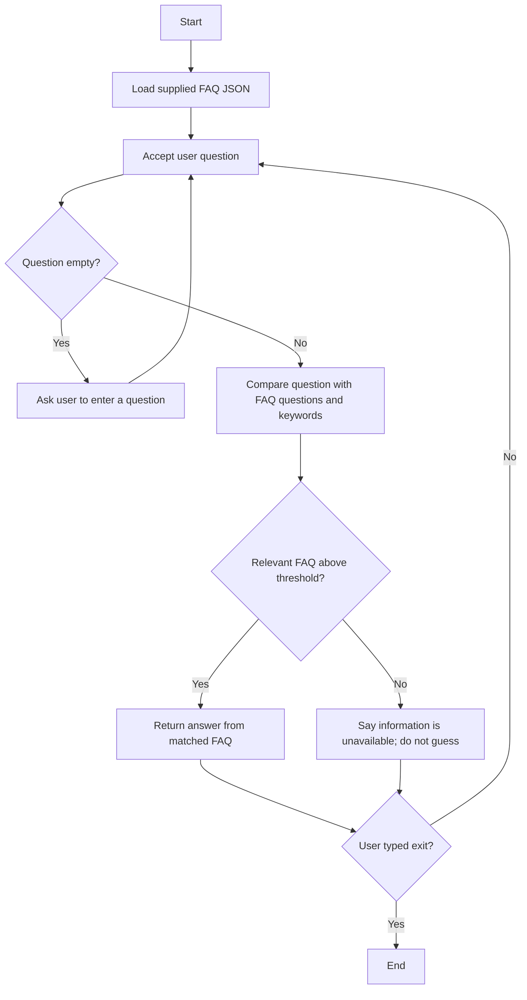

# Workflow Diagram

## Workflow Explanation
1. The application loads the FAQ list from `data/faqs.json`.
2. The user types a question.
3. The program compares words in the question with each FAQ question and its keywords.
4. If the best match reaches the configured threshold, it returns that FAQ's stored answer.
5. If no relevant match is found, it returns a safe fallback and directs the user to verify with the institute office.
6. The program does not create new institute rules or policies.
