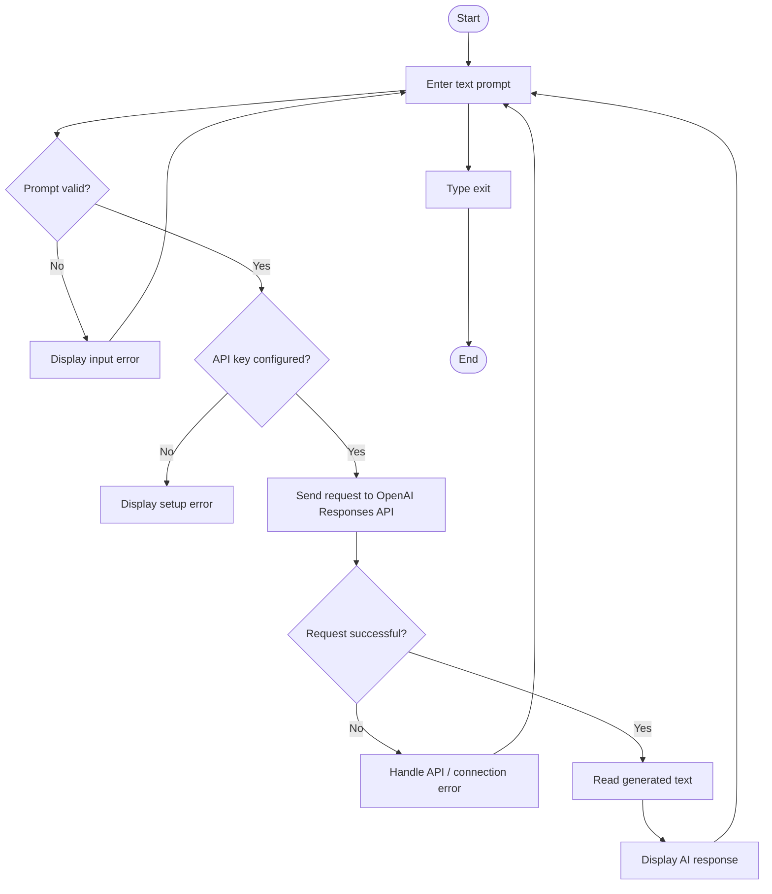

# Practical 36: API Integration with AI

**Module:** AI Automation & Workflow Integration — Module 4, Part 2  
**Student Name:** [Enter your name]  
**GRID Number:** [Enter your GRID number]  
**Practical Number:** 36

## 1. Problem Statement

Create a small Python application that accepts a text prompt, sends it to an AI service through its official API, processes the response, and displays the generated text. The application must validate input, protect the API key, and handle common errors.

## 2. Objectives

- Read the official API documentation.
- Store the API key outside the source code.
- Send a valid request to the AI service.
- process and display the response.
- Handle empty/oversized input, authentication problems, quota/rate-limit issues, connection errors, and API errors.
- Use GitHub-safe project files and document testing.

## 3. Tools and Integrations Used

- **Python 3.10 or newer** — application language.
- **OpenAI Python SDK** — communicates with the official OpenAI API.
- **OpenAI Responses API** — accepts the prompt and returns generated text.
- **python-dotenv** — reads environment variables from a local `.env` file.
- **Git and GitHub** — version control and submission.
- **unittest** — tests prompt validation without making API calls.

Official documentation:
- API quickstart: https://platform.openai.com/docs/quickstart
- Responses API reference: https://platform.openai.com/docs/api-reference/responses
- API key safety: https://platform.openai.com/docs/guides/production-best-practices

> API access may require an API account and billing/credits. ChatGPT access and API usage are separate. Check current account limits before running live requests.

## 4. Workflow Diagram



## 5. How the Application Works

1. The user types a prompt in the terminal.
2. The program trims spaces and checks that the prompt is not empty and is no longer than 4,000 characters.
3. The program loads `OPENAI_API_KEY` from the local environment.
4. The OpenAI Python SDK sends the prompt to the Responses API.
5. The application reads `response.output_text`.
6. The generated response is printed in the terminal.
7. Known errors are displayed in simple language. The program does not print the API key.

## 6. Prompt and Sample Input

**System instruction used by the app:**

> You are a helpful educational assistant. Give clear, concise answers. If a request is unclear, ask a clarifying question. Do not invent facts.

**Sample user input:**

```text
Explain what an API is in simple English and give one real-life example.
```

**Illustrative example of expected output** (actual wording will vary):

```text
An API is a way for two software applications to communicate.
For example, a weather app can request weather information from a weather service through an API.
```

## 7. Installation and Execution

### Requirements

Install Python 3.10+ and make sure Git is installed if you plan to upload the project to GitHub.

### Windows instructions

Open Command Prompt or the VS Code terminal inside this project folder:

```bash
python -m venv .venv
.venv\Scripts\activate
pip install -r requirements.txt
```

Create a local `.env` file by copying `.env.example` and then put your own API key in `.env`. You can do this in File Explorer or use:

```bash
copy .env.example .env
```

Open `.env` in a text editor and replace the placeholder value with your own key. **Do not share or upload `.env`.** Then run:

```bash
python app.py
```

Type a question, for example `Explain JSON in simple words`. Type `exit` to close the program.

### Run validation tests

```bash
python -m unittest discover -s tests -v
```

These tests do not require an API key and do not call the AI service.

## 8. API Request and Response Processing

The application uses the official OpenAI Python SDK and the Responses API:

```python
response = client.responses.create(
    model=model,
    instructions="Give clear, concise answers. Do not invent facts.",
    input=prompt,
)
answer = (response.output_text or "").strip()
```

The SDK handles the HTTP request and JSON response parsing. The program checks that returned text is not empty before displaying it.

## 9. Test Cases and Results

| Test ID | Input / condition | Expected result | Test method / result |
|---|---|---|---|
| T01 | Prompt contains normal text | Spaces trimmed and prompt accepted | Automated unit test |
| T02 | Empty or spaces-only prompt | Input error; no API request | Automated unit test |
| T03 | Prompt exceeds 4,000 characters | Input error; no API request | Automated unit test |
| T04 | API key is missing | Setup error displayed | Manual test: remove `OPENAI_API_KEY` from `.env` |
| T05 | API key is invalid | Authentication error displayed | Manual test: use a deliberately invalid key locally; do not publish it |
| T06 | Network is unavailable | Connection error displayed | Manual test |
| T07 | Valid prompt and working API credentials | Generated response displayed | Live API test; requires API access |
| T08 | API quota/rate limit reached | Helpful quota/rate-limit message | Manual/conditional test |

**Important:** Run the tests on your own computer and record the actual results before submission. Do not claim a live API test passed unless you ran it successfully.

## 10. Error-Handling Approach

- **Invalid input:** rejects empty prompts and prompts longer than 4,000 characters.
- **Missing key:** explains that the local `.env` file must be configured.
- **Authentication error:** asks the user to check the key.
- **Rate limit/quota error:** advises checking API usage and limits.
- **Connection error:** asks the user to check internet access.
- **Bad request/API status error:** displays a concise error message.
- **Empty response:** reports that no text was returned.
- **Unexpected error:** displays the error type without printing secrets.

## 11. Security Considerations

- The API key is read from `.env`, not hard-coded in `app.py`.
- `.env` is included in `.gitignore`.
- Only `.env.example` with a fake placeholder is included in the repository.
- Never commit, screenshot, or share a real API key.
- If a key is accidentally published, revoke it and create a replacement.
- Use sample prompts; do not submit private student information or confidential data.
- Review AI output for accuracy before relying on it.
- API calls may incur charges depending on account and model usage.

## 12. GitHub Submission Steps

1. Create a new GitHub repository, for example `practical-36-ai-api-integration`.
2. Upload the project files and folders:
   - `app.py`
   - `requirements.txt`
   - `.env.example`
   - `.gitignore`
   - `README.md`
   - `tests/test_validation.py`
3. Confirm that `.env` is **not** uploaded.
4. Add your name and GRID number to this README.
5. Run the validation tests and the live API test if you have API access.
6. Add genuine screenshots of the terminal showing the app running and the test results. Do not include the API key in screenshots.
7. Submit the GitHub repository URL as required by your instructor.

### Suggested screenshots to add

Create a `screenshots` folder in your repository and add:
- `01_app_response.png` — a successful prompt and response.
- `02_validation_error.png` — empty prompt validation.
- `03_unit_tests.png` — unit test results.

These screenshots are not included because they must show your own actual run.

## 13. Conclusion and Learning Outcomes

This practical demonstrates how a Python application can send a prompt to an AI service through an official API. It uses environment variables for authentication, validates user input, processes the response, and handles common errors. The project also demonstrates testing and safe preparation for a public GitHub repository.

**Learning outcomes achieved by the design:** API request structure, SDK-based authentication, response processing, input validation, error handling, and API-key security. Complete the live API test and screenshots on your computer to document practical execution.

The input validation helper is kept in `validation.py` so its unit tests can run independently of API credentials and the OpenAI SDK installation.
