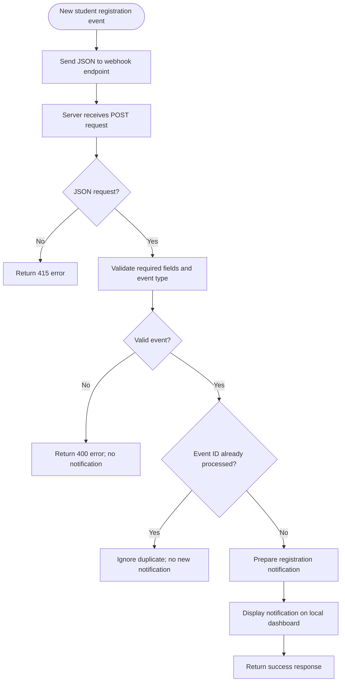

# Practical 37: Webhook-Based Notification

**Module:** AI Automation & Workflow Integration — Module 4, Part 2  
**Practical Number:** 37  
**Student Name:** [Enter your name]  
**GRID Number:** [Enter your GRID number]

## 1. Problem Statement

Build a demonstration workflow that receives a sample event for a new student registration and prepares a notification. The application must reject invalid events and prevent duplicate event IDs from creating unwanted notifications.

## 2. Objectives

- Receive a webhook-style HTTP POST request.
- Read student details from a JSON payload.
- Validate required fields and the event type.
- Prepare and display a registration notification.
- Reject invalid requests and ignore duplicate events.
- Test the workflow with valid, invalid, and duplicate sample events.

## 3. Tools and Integrations Used

- **Python 3.10+** — application logic.
- **Flask** — local HTTP server and webhook endpoint.
- **JSON** — event payload and response format.
- **Python `unittest`** — automated tests.
- **Git and GitHub** — project version control and submission.

This practical follows the provided module's webhook workflow:  
**Event Occurs → Webhook Sends Data → Server Receives Request → Validate Event → Execute Appropriate Action**

## 4. Workflow Diagram



## 5. Sample Event Input

The file `send_sample_event.py` sends this example JSON payload:

```json
{
  "event_id": "registration-demo-001",
  "event": "student.registration.created",
  "student_name": "Aarav Patel",
  "course": "Generative AI"
}
```

## 6. Expected Notification

For a valid event, the server prepares a notification similar to:

```text
New Student Registration
Aarav Patel registered for Generative AI.
```

The response includes `status: success`, `notification_created: true`, and the notification details. Actual timestamps are generated when the event is received.

## 7. Installation and Execution

Install Python 3.10 or newer. Open a terminal in this project folder.

### Windows

```bash
python -m venv .venv
.venv\Scripts\activate
pip install -r requirements.txt
```

Start the webhook server:

```bash
python app.py
```

Keep that terminal open. In a second terminal, activate the same virtual environment and run:

```bash
python send_sample_event.py
```

Open `http://127.0.0.1:5000` in a browser to view notifications. The health endpoint is `http://127.0.0.1:5000/health`.

The sample sender sends the same event twice, allowing you to observe that the first event creates a notification and the duplicate is ignored.

## 8. Test Cases and Results

| Test ID | Test input | Expected result | Automated test |
|---|---|---|---|
| T01 | Valid student registration | HTTP 201; notification created | `test_valid_event_creates_notification` |
| T02 | Student name missing/blank | HTTP 400; no notification | `test_missing_student_name_is_rejected` |
| T03 | Same event ID submitted twice | Second event ignored; notification count stays at one | `test_duplicate_event_does_not_create_second_notification` |
| T04 | Unsupported event type | HTTP 400; no notification | `test_unsupported_event_is_rejected` |
| T05 | Request is not JSON | HTTP 415; no notification | `test_non_json_request_is_rejected` |

Run tests:

```bash
python -m unittest discover -s tests -v
```

**Results note:** Run the tests on your computer before submission and retain a screenshot of the actual test output. Do not claim that a test passed unless you ran it.

## 9. Error-Handling Approach

- Missing or blank required fields are rejected with HTTP 400.
- Unsupported event types are rejected with HTTP 400.
- Requests without JSON content type are rejected with HTTP 415.
- Repeated event IDs return `duplicate_ignored` and do not create another notification.
- Request size is limited to 16 KB.
- The sample sender reports connection errors if the server is not running.

## 10. Security and Reliability Considerations

- The app binds to `127.0.0.1`, so this demonstration is intended for local use.
- Do not expose this demo server publicly without authentication, HTTPS, and appropriate request verification.
- Use sample student details; do not use real confidential student information.
- Duplicate detection uses a set held in memory. It resets when the server restarts and is suitable only for a classroom demonstration. A production system should use persistent storage and an atomic uniqueness check.
- The notification is prepared and displayed locally; it is not sent to a real email, SMS, or messaging service.

## 11. GitHub Submission Steps

1. Create a repository named `practical-37-webhook-notification`.
2. Upload `app.py`, `send_sample_event.py`, `requirements.txt`, `.gitignore`, `README.md`, and `tests/test_webhook.py`.
3. Add your student name and GRID number to this README.
4. Run the application and all tests locally.
5. Add a `screenshots` folder with genuine screenshots:
   - `01_dashboard_notification.png` — local dashboard showing the notification.
   - `02_duplicate_event.png` — terminal output for first and duplicate event.
   - `03_unit_tests.png` — automated test output.
6. Check that screenshots do not show private data.
7. Submit the GitHub repository URL to your instructor.

## 12. Conclusion and Learning Outcomes

This practical demonstrates a webhook-style workflow for new student registration. A JSON event is received by a local endpoint, validated, checked for duplicate event IDs, and converted into a notification. Invalid and repeated events are prevented from creating unwanted notifications. The project demonstrates HTTP requests, JSON payloads, validation, conditional logic, basic error handling, and automated testing.
