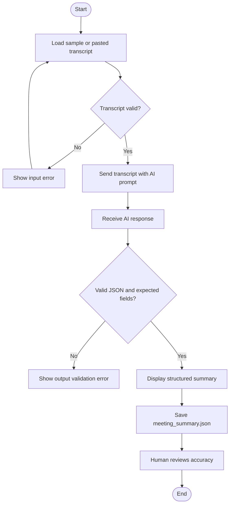

# Practical 38: AI Meeting Summary Workflow

**Module:** AI Automation & Workflow Integration — Module 4, Part 2  
**Practical Number:** 38  
**Student Name:** [Enter your name]  
**GRID Number:** [Enter your GRID number]

## 1. Problem Statement

Create a workflow that accepts a sample meeting transcript and uses AI to return the main discussion points, decisions, action items, and responsible roles. The AI must not invent deadlines or decisions that are not present in the transcript. The structured result is displayed and saved as JSON.

## 2. Objectives

- Use a sample meeting transcript.
- Create a clear AI prompt for meeting summarization.
- Return structured JSON output.
- Extract discussion points, decisions, action items, and responsible roles.
- Validate input and the response structure.
- Handle common API and invalid-output errors.
- Save the result for later review.

## 3. Tools and Integrations Used

- **Python 3.10+** — application logic.
- **OpenAI Python SDK / Responses API** — AI summarization.
- **python-dotenv** — load the API key from a local `.env` file.
- **JSON** — structured output format.
- **unittest** — input-validation tests.
- **Git and GitHub** — version control and submission.

Official documentation:
- API quickstart: https://platform.openai.com/docs/quickstart
- Responses API reference: https://platform.openai.com/docs/api-reference/responses
- API key safety: https://platform.openai.com/docs/guides/production-best-practices

API access and billing/credits may be required. ChatGPT access and API usage are separate.

## 4. Workflow Diagram



## 5. Sample Meeting Transcript

The file `sample_transcript.txt` contains a classroom-safe example:

> Participants discussed the upcoming student project demonstration. The team agreed that the demonstration should show the main features of the project and include a short explanation of how it works. The project coordinator will collect the latest project files from team members. The design lead will prepare the demonstration slides. The team did not agree on a presentation date during this meeting. The group also noted that the testing status should be checked before the demonstration, but no person was assigned to that task.

## 6. Prompt Used

The application sends this instruction to the AI:

> Summarize the meeting transcript provided by the user. Return valid JSON with main discussion points, decisions, action items and responsible roles, and missing information. Do not invent deadlines, decisions, names, or action items that are not in the transcript. If a section has no supported items, return an empty array. Use only the transcript as the source of meeting facts.

## 7. Expected Structured Output

Actual AI wording can vary. The output should follow this structure:

```json
{
  "main_discussion_points": [
    "The team discussed the upcoming student project demonstration.",
    "The demonstration should cover main features and explain how the project works.",
    "Testing status should be checked before the demonstration."
  ],
  "decisions": [
    "The demonstration will show the main project features and include a short explanation."
  ],
  "action_items": [
    {
      "task": "Collect the latest project files from team members.",
      "responsible_role": "Project coordinator"
    },
    {
      "task": "Prepare the demonstration slides.",
      "responsible_role": "Design lead"
    }
  ],
  "missing_information": [
    "The presentation date was not decided.",
    "No person was assigned to check the testing status."
  ]
}
```

This is an illustrative example, not a claim that a live API request has been run.

## 8. Installation and Execution

### Windows

Open a terminal in this project folder:

```bash
python -m venv .venv
.venv\Scripts\activate
pip install -r requirements.txt
```

Copy `.env.example` to `.env`:

```bash
copy .env.example .env
```

Open `.env` and replace the placeholder with your own API key. Do not upload `.env` to GitHub.

Run the application:

```bash
python app.py
```

Paste the transcript into the terminal, then type `END` on a separate line. The program prints the structured summary and saves it to `meeting_summary.json`. Type `EXIT` at the first prompt to close the app.

To use the sample transcript, open `sample_transcript.txt` and copy its text into the application.

### Run input-validation tests

```bash
python -m unittest discover -s tests -v
```

These tests do not require API access.

## 9. Test Cases and Results

| Test ID | Input / condition | Expected result | Test method |
|---|---|---|---|
| T01 | Normal non-empty transcript | Transcript accepted | Automated unit test |
| T02 | Empty transcript | Input error; no API call | Automated unit test |
| T03 | Transcript over 12,000 characters | Input error; no API call | Automated unit test |
| T04 | Valid transcript and working API key | Structured summary displayed and saved | Live API test |
| T05 | Invalid API key | Authentication error shown | Manual test |
| T06 | API returns invalid JSON or wrong fields | Output validation error shown | Manual/conditional test |
| T07 | Transcript has no stated deadline | Summary must not invent a deadline | Review output against transcript |

Run tests locally and record actual results before submission. Do not claim live API tests passed unless you ran them.

## 10. Error-Handling Approach

- Rejects an empty transcript.
- Rejects transcripts longer than 12,000 characters.
- Detects missing API configuration.
- Handles authentication, rate-limit/quota, connection, and API errors.
- Checks whether the AI response is valid JSON.
- Checks required output keys and verifies action-item structure.
- Reports errors without printing the API key.

## 11. Security and Responsible AI Considerations

- The API key is stored in a local `.env` file and excluded by `.gitignore`.
- Only `.env.example` with a placeholder key is included in the repository.
- Use sample or approved transcripts; do not upload confidential meeting details without permission.
- AI summaries can omit context or make mistakes. A human should verify decisions and action items before sharing them.
- The application does not create deadlines or assign people where the transcript does not provide that information.
- API usage may incur charges depending on account and model.

## 12. GitHub Submission Steps

1. Create a GitHub repository named `practical-38-ai-meeting-summary`.
2. Upload `app.py`, `sample_transcript.txt`, `requirements.txt`, `.env.example`, `.gitignore`, `README.md`, and `tests/test_validation.py`.
3. Enter your student name and GRID number in this README.
4. Run the app and tests locally.
5. Create a `screenshots` folder and add genuine screenshots:
   - `01_sample_transcript.png` — transcript being supplied.
   - `02_structured_summary.png` — output in terminal.
   - `03_unit_tests.png` — test results.
6. Ensure screenshots do not expose your API key or private meeting data.
7. Submit the GitHub repository URL to your instructor.

## 13. Conclusion and Learning Outcomes

This practical demonstrates an AI meeting-summary workflow. It takes a transcript as input, sends it with a structured prompt to an AI service, validates the returned JSON, displays the discussion points, decisions, action items, and responsible roles, and saves the result. It demonstrates summarization, structured output, workflow integration, validation, error handling, and human review.
