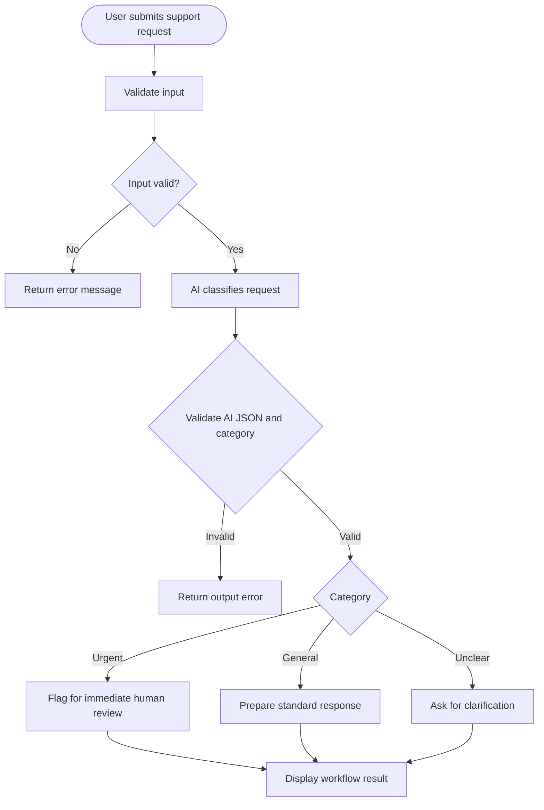

# Practical 39: AI Workflow with Conditions

**Module:** AI Automation & Workflow Integration — Module 4, Part 2  
**Practical Number:** 39  
**Student Name:** [Enter your name]  
**GRID Number:** [Enter your GRID number]

## 1. Problem Statement
Create an AI-assisted workflow that categorizes support requests and applies conditional rules:
- Urgent requests → flag for immediate human review.
- General requests → prepare a standard response.
- Unclear requests → ask for clarification.
- Invalid input → return an error message.

The workflow validates input, checks AI output, and preserves human oversight for urgent requests.

## 2. Objectives
- Accept a support request from the user.
- Validate input before calling the AI service.
- Use an AI prompt to classify the request.
- Apply conditional branching based on the category.
- Prepare the appropriate next action or response.
- Handle invalid inputs and common API errors.
- Test the workflow with sample cases.

## 3. Tools and Integrations Used
- **Python 3.10+** — workflow logic.
- **OpenAI Python SDK / Responses API** — support request classification.
- **python-dotenv** — loads the API key from a local `.env` file.
- **JSON** — structured AI output and sample test data.
- **unittest and unittest.mock** — automated validation and conditional-rule tests.
- **Git and GitHub** — project version control and submission.

Official documentation:
- API quickstart: https://platform.openai.com/docs/quickstart
- Responses API reference: https://platform.openai.com/docs/api-reference/responses
- API key safety: https://platform.openai.com/docs/guides/production-best-practices

API access and billing/credits may be required. ChatGPT access and API usage are separate.

## 4. Workflow Diagram



## 5. Prompt Used
The application instructs the AI to classify a support message and return valid JSON with:
- `category`: `urgent`, `general`, or `unclear`
- `summary`: brief summary based only on the request
- `reason`: short explanation for the classification

The prompt says not to invent facts, to use `urgent` for clearly time-sensitive problems or serious blockages, and to use `unclear` when there is not enough information. Urgent cases are flagged for a human rather than automatically finalized.

## 6. Sample Inputs and Expected Actions
The file `sample_requests.json` contains sample cases.

| Sample request | Expected category | Expected workflow action |
|---|---|---|
| Student portal is down right before a submission deadline | Urgent | Flag for immediate human review |
| Asking where to find the course timetable | General | Prepare a standard response |
| "It is not working. Please help." | Unclear | Ask for clarification |
| Empty input | Invalid | Return an error; do not call AI |

AI classification can vary. Verify actual output against these expected actions when testing.

## 7. Conditional Logic
1. If category is `urgent`, route to `human_review` and do not prepare an automatic final response.
2. If category is `general`, prepare a standard acknowledgement response.
3. If category is `unclear`, prepare a clarification question.
4. If input is empty or too long, validation returns an error before an API request is made.
5. If AI output is invalid JSON or contains an unexpected category, return an output error instead of routing it.

## 8. Installation and Execution

### Windows
Open a terminal in this project folder:

```bash
python -m venv .venv
.venv\Scripts\activate
pip install -r requirements.txt
```

Copy `.env.example` to `.env`:

```bash
copy .env.example .env
```

Open `.env` and add your own API key. Never upload `.env` to GitHub.

Run:

```bash
python app.py
```

Type a support request and press Enter. Type `EXIT` to close the app.

## 9. Test Cases and Results

| Test ID | Input / condition | Expected result | Test coverage |
|---|---|---|---|
| T01 | Valid text with surrounding spaces | Trims and accepts input | Automated |
| T02 | Empty input | Error; no AI call | Automated |
| T03 | Message over 3,000 characters | Error; no AI call | Automated |
| T04 | AI category is urgent | Human review route; no automatic final response | Automated rule test |
| T05 | AI category is general | Standard response prepared | Automated rule test |
| T06 | AI category is unclear | Clarification response prepared | Automated rule test |
| T07 | Live AI classification | Structured workflow result displayed | Manual live API test |

Run automated tests:

```bash
python -m unittest discover -s tests -v
```

Unit tests mock classification for rule testing and do not require API access. Run the live test separately and record its actual result. Do not claim a test passed unless you ran it.

## 10. Error-Handling Approach
- Empty and oversized messages are rejected before the API call.
- Missing API key produces a configuration error.
- Authentication, rate-limit/quota, connection, and API status errors are handled.
- Invalid JSON, unexpected categories, or missing output fields are rejected.
- The app avoids printing the API key.
- Urgent requests are flagged for human review.

## 11. Security and Responsible AI Considerations
- API key is stored in local `.env`, excluded by `.gitignore`.
- Only `.env.example` with a placeholder key is included in the repository.
- Use sample or approved support messages; avoid sending private student information.
- AI classification can be wrong. A human should review urgent or consequential cases.
- The app prepares a response but does not send it automatically.
- API usage may incur charges depending on the account and model.

## 12. GitHub Submission Steps
1. Create a repository named `practical-39-ai-workflow-conditions`.
2. Upload `app.py`, `requirements.txt`, `.env.example`, `.gitignore`, `sample_requests.json`, `README.md`, and `tests/test_workflow.py`.
3. Add your student name and GRID number to this README.
4. Run the application and automated tests.
5. Add a `screenshots` folder with genuine screenshots:
   - `01_urgent_request.png` — urgent request routed to human review.
   - `02_general_request.png` — standard response prepared.
   - `03_unclear_request.png` — clarification question prepared.
   - `04_invalid_input.png` — invalid input error.
   - `05_unit_tests.png` — automated test output.
6. Ensure screenshots do not show an API key or confidential data.
7. Submit the GitHub repository URL to your instructor.

## 13. Conclusion and Learning Outcomes
This practical demonstrates AI-based support request classification and conditional branching. The workflow validates input, classifies the request into urgent, general, or unclear, and applies the corresponding action. It rejects invalid AI output and keeps human oversight for urgent cases. The practical covers classification, conditional logic, structured JSON, error handling, testing, and responsible AI use.
