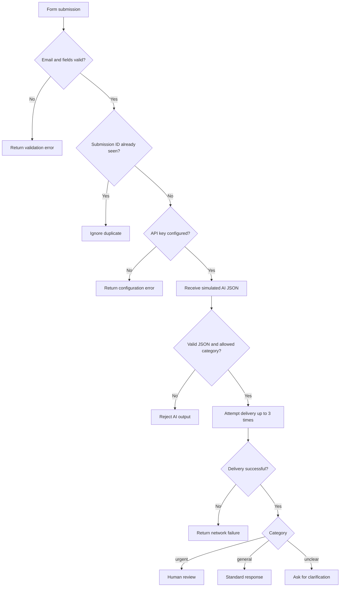

# Practical 40: Workflow Troubleshooting Challenge

**Student Name:** `[Enter your full name]`  
**GRID Number:** `[Enter your GRID number]`  
**Subject / Course:** `[Enter subject or course name]`

## 1. Problem Statement
An automated workflow can fail when required form fields are missing, AI output is malformed, credentials are incorrect, a form is submitted more than once, a network request fails, or an AI response contains an unsupported category. The objective is to identify each failure, explain its root cause, and demonstrate a safe correction.

## 2. Objectives
- Detect missing or invalid email addresses before processing.
- Reject malformed JSON and unexpected AI categories.
- Handle missing/placeholder API-key configuration without exposing secrets.
- Prevent duplicate processing using a submission ID.
- Retry transient network failures a bounded number of times.
- Test the corrected workflow and document results.

## 3. Tools and Technologies
- Python 3.10 or later
- Python standard library: `json`, `re`, `time`, `unittest`
- Git and GitHub for version control and submission
- AI response is simulated as sample JSON so the practical runs offline and does not require a paid API.

## 4. Workflow Diagram


## 5. Deliberate Issues, Causes, and Corrections

| Deliberate issue | Root cause | Correction implemented |
|---|---|---|
| Missing email address | Required contact field is empty or malformed | `valid_email()` validates before any workflow action |
| Incorrect JSON format | AI output cannot be parsed as JSON | `parse_ai_json()` catches parse errors and returns a controlled failure |
| Invalid API key | Key is missing, blank, or a placeholder/known invalid demo value | Configuration check stops processing; real keys should be read from environment variables |
| Duplicate form submission | The same `submission_id` arrives again | `seen_ids` tracks processed IDs for this run and ignores repeats |
| Failed network request | Temporary request errors or unsuccessful delivery | `send_with_retry()` retries at most three times, then fails clearly |
| Unexpected AI category | Model returns a value outside the expected categories | Allowlist only accepts `urgent`, `general`, and `unclear` |

> This is a classroom simulation. The API-key check is illustrative, the AI output is supplied as a string, and delivery is simulated. In production, verify credentials with the actual provider and store idempotency keys persistently.

## 6. Prompt Used for the AI Classification Step
When adapting this workflow to a real AI provider, use a constrained prompt such as:

```text
Classify the support message into exactly one category: urgent, general, or unclear.
Return one valid JSON object only, with keys "category" and "reason".
Do not add Markdown fences or any text outside the JSON object.
Message: {{message}}
```

The program must still validate the returned JSON. A prompt alone is not a substitute for validation.

## 7. Sample Inputs and Expected Results

### Valid input (`sample_input.json`)
```json
{
  "submission_id": "FORM-1001",
  "email": "student@example.com",
  "message": "My account is locked and I need help."
}
```
AI output (`sample_ai_output.json`):
```json
{"category":"urgent","reason":"The user cannot access their account."}
```
Expected route: `human_review`.

### Malformed JSON
```text
{category: urgent}
```
Expected result: rejected with `Incorrect JSON format from AI step`.

### Unexpected category
```json
{"category":"maybe"}
```
Expected result: rejected because `maybe` is not an allowed category.

### Duplicate submission
Submit the same `submission_id` twice using the same `seen_ids` set. The second request is ignored.

## 8. Setup and Run Instructions
Python 3.10+ is recommended. No third-party package installation is needed.

Windows Command Prompt / PowerShell:
```bash
python --version
python app.py
python -m unittest discover -s tests -v
```

If `python` is not recognized, install Python from the official Python website and enable the option to add Python to PATH. The `.env.example` file is only a configuration example; this offline demo does not read or require an actual API key.

## 9. Test Cases and Results
Run the test command above. The test suite checks:

| Test | Expected result |
|---|---|
| Valid email | Accepted |
| Empty or malformed email | Rejected at validation stage |
| Incorrect JSON | Controlled parsing error |
| Unexpected category | Rejected by allowlist |
| Missing/invalid demo API key | Authentication/configuration error |
| Duplicate submission ID | Second submission ignored |
| Network succeeds on retry | Workflow continues after retry |
| Network fails all attempts | Clear delivery error after 3 attempts |
| Urgent category | Routed to human review |

Record the actual result of your run in your submission notes; do not claim tests passed unless you ran them.

## 10. Error-Handling Approach
- Return a structured result with `ok`, `stage`, and `error` fields for failures.
- Validate form data before invoking the AI/delivery steps.
- Catch JSON parse errors rather than crashing.
- Restrict categories to a known allowlist.
- Retry network operations a fixed number of times and then stop.
- Do not expose API keys, tokens, or private form data in error messages.

## 11. Security and Responsible AI
- Never commit a real API key or `.env` file. `.gitignore` excludes `.env`.
- Use environment variables or a managed secrets store for real credentials.
- Collect only the data needed for the task; avoid putting sensitive personal information in test samples.
- Treat AI classification as fallible. For urgent cases, route to a human rather than relying on the model alone.
- Validate model output in code; do not trust instructions or categories returned by a model without checking them.
- This demo performs no actual email sending, external API request, or data upload.

## 12. Screenshots / Demonstration Evidence
Capture your own screenshots after running the project. Save them in this folder and reference them here:

1. `screenshots/app-output.png` — terminal showing the six issue diagnoses and sample output.
2. `screenshots/test-results.png` — terminal showing the unit-test results.
3. `screenshots/github-repository.png` — your GitHub repository page after upload.

Do not submit placeholder images as evidence. If your instructor requires a workflow execution screenshot, run `python app.py` and capture the real terminal output.

## 13. GitHub Submission Steps
1. Replace the Student Name, GRID Number, and course placeholders at the top of this README.
2. Run `python app.py` and `python -m unittest discover -s tests -v`.
3. Capture real screenshots and save them under `screenshots/`.
4. Create a public or instructor-approved private GitHub repository named `Practical-40-Workflow-Troubleshooting`.
5. Upload the project files and folders. Do not upload `.env` or any real credentials.
6. Open the repository page and confirm that `README.md`, `app.py`, `tests/`, sample JSON files, and screenshots are visible.
7. Submit the repository URL using your institute's required submission method.

## 14. Conclusion and Learning Outcomes
This practical demonstrates a systematic troubleshooting process: reproduce or identify the failure, locate its cause, implement a targeted correction, and verify the correction with tests. The workflow uses input validation, JSON parsing, allowlist checks, duplicate protection, bounded retries, structured errors, and basic secret-handling practices.
